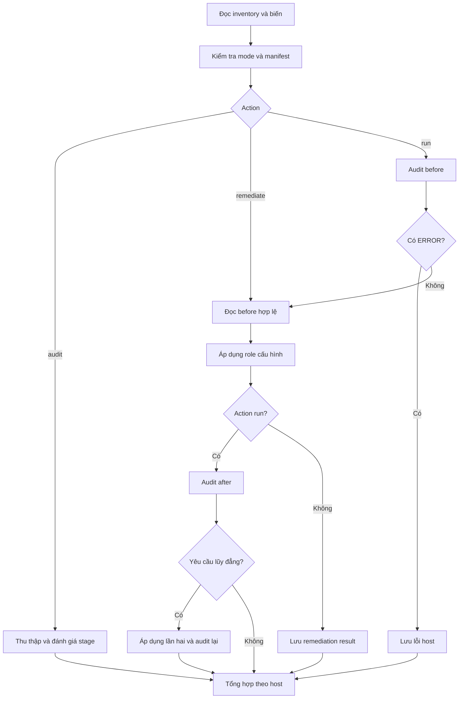

# Cấu trúc và logic Ansible-native

```text
site.yml                         Local entry point
playbooks/remote.yml              Remote entry point
playbooks/workflow.yml            audit/remediate/run theo host
playbooks/tasks/                  identity, stage, remediation, idempotence, summary
playbooks/templates/              JSON/CSV tổng hợp và source hash
roles/cis_audit/defaults/         lựa chọn audit và ngưỡng chính sách
roles/cis_audit/vars/main.yml     30 định nghĩa tiêu chí: passed/error/review/detail
roles/cis_audit/tasks/collect.yml command đọc NGINX/APT/socket/find
roles/cis_audit/tasks/probes.yml  account/stat/HTTP/TLS
roles/cis_audit/templates/        lexer Jinja giữ quote/comment/block/include; báo cáo
roles/nginx_cis/                  role khắc phục: defaults/tasks/templates/handlers
inventory/                       Local và mẫu bốn EC2
config/workflow.yml               action/scope/stage/run ID
config/lab.example.yml            biến chính sách/site có thể tùy chỉnh
 tests/                          fixture YAML và native regression playbooks
```

Không còn `audit/*.py`, `scripts/*.py`, custom filter/module/callback Python hoặc CLI cisctl.
Chỉ cần ansible-core và module tích hợp. Core/module Ansible vẫn dựa trên Python.

## Luồng sau Enter



Audit: command/stat lấy dữ liệu bằng `register`; Jinja lexer phân tích `nginx -T` theo block,
giữ include context; `set_fact` tính kết quả từng tiêu chí; template ghi report tại controller.
Không dùng `assert` cho từng FAIL vì cần tiếp tục đủ tiêu chí; assert cuối quy trình trả nonzero.

Remediation giữ cách hoạt động đã học: preflight → role section tích lũy → render candidate →
nginx -t → copy nếu khác → notify validate/reload → kiểm tra service → lưu profile.
Không đọc CSV để chỉ chạy FAIL. Tác vụ mutation có thêm notify `Record remediation change` để
đánh dấu thay đổi thực khi kiểm tra lũy đẳng. Công việc ghi báo cáo không tham gia phép đo này.

## Phạm vi

| Section | CIS ID | Số |
|---|---|---:|
|1|1.1.1, 1.2.1, 1.2.2|3|
|2|2.1.1, 2.2.1–2.2.3, 2.3.1–2.3.3, 2.4.1–2.4.4, 2.5.1–2.5.3|14|
|3|3.1–3.3|3|
|4|4.1.1, 4.1.3–4.1.6|5|
|5|5.2.1–5.2.3, 5.3.1, 5.3.3|5|

Điều kiện cụ thể và lý do/ERROR/REVIEW nằm trực tiếp ở `roles/cis_audit/vars/main.yml`.
Đây là đánh giá phạm vi lab/website được chọn, không phải bộ chứng nhận mọi cấu hình NGINX.
Nguồn yêu cầu: CIS NGINX Benchmark v3.0.0. API thực thi:
https://docs.ansible.com/projects/ansible/latest/collections/ansible/builtin/index.html
