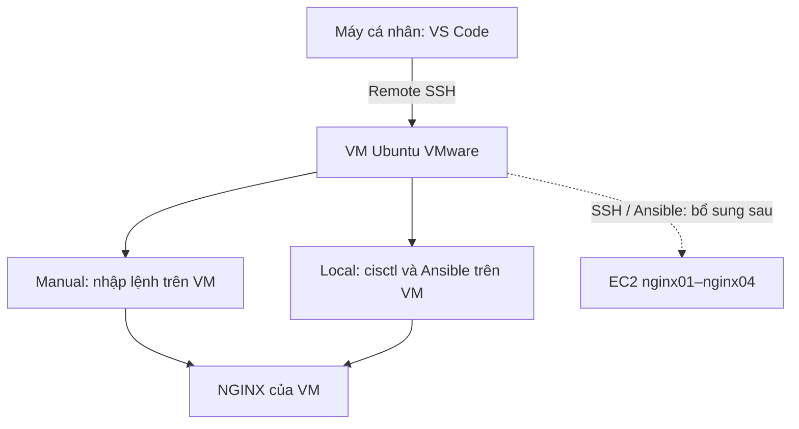

# Mô hình lab và bảng thành phần

Manual và Local Automated cùng thực hiện trên VM Ubuntu; VS Code kết nối SSH vào VM để mở terminal. Vị trí cửa sổ terminal trên Windows không biến lệnh Ansible có `ansible_connection: local` thành Remote Automated. Remote chỉ có khi Ansible từ controller điều khiển các máy EC2 riêng.



Nét đứt là phần dự kiến; repo chưa chạy được triển khai Remote. Không cần EC2 thứ năm: VM có thể đồng thời là máy lab Local và controller trong giai đoạn Remote sau này.

| Thành phần | Trạng thái trong repo | Địa chỉ cần ghi vào báo cáo | Công cụ / vai trò |
|---|---|---|---|
| Máy cá nhân | Giao diện thao tác | IP LAN thực tế; IP public đường ra khi cần | VS Code, extension Remote - SSH, SSH client, phần mềm quay màn hình |
| VM Ubuntu Server 26.04 (VMware) | Đích Manual/Local; controller Remote dự kiến | IP VM thực tế, chế độ NAT/bridged, IP public đường ra | Python 3, venv, Ansible, Git, sudo, curl, OpenSSL, iproute2, systemd; NGINX sau khi cài |
| EC2 nginx01 | Chưa triển khai; TV1 quản lý | Public IP/DNS, private IP, region/VPC: để nhóm điền | Ubuntu 24.04, Python 3, SSH, sudo, systemd; NGINX và các công cụ audit sẽ được bổ sung |
| EC2 nginx02 | Chưa triển khai; TV2 quản lý | Để nhóm điền | Như nginx01 |
| EC2 nginx03 | Chưa triển khai; TV3 quản lý | Để nhóm điền | Như nginx01 |
| EC2 nginx04 | Chưa triển khai; TV4 quản lý | Để nhóm điền | Như nginx01 |

`127.0.0.1` trong inventory Local là loopback của VM, không phải địa chỉ để VS Code từ Windows kết nối vào. Không tự điền địa chỉ IP ví dụ thành địa chỉ thực nghiệm.

Thu thập thông tin VM trên terminal VS Code đã kết nối vào VM:

```bash
hostname
ip -br address
ip route
cat /etc/os-release
python3 --version
ansible --version
nginx -v
```

Ghi rõ lệnh chạy trước hay sau khi cài NGINX. Lệnh `nginx -v` có thể chưa tồn tại trên baseline chưa cài đặt. Với EC2, bổ sung thông tin network và Security Group từ tài khoản của chủ máy; không suy ra IP EC2 từ IP VM.

Đưa bảng thông tin thực tế và mô hình vào chương 3. Đưa cấu trúc thư mục, logic audit/remediation và ví dụ code vào chương 2. Quy trình quay và baseline nằm ở [DEMO.md](DEMO.md); việc bổ sung Remote nằm ở [REMOTE.md](REMOTE.md).
